<div align="center">



<br/><br/>



<br/><br/>



<br/><br/>

**🚀 I make real-world C++ codebases safer, one validated input at a time.**

_Last updated: November 2026_

</div>

<br/>



Hi, I'm **Harshit Gupta** 👋

This repository is a living record of my open-source work: what I fixed, why it mattered, and how each pull request went from first commit to merge. My core focus is **defensive programming**: making software fail clearly and safely when it receives bad input, and proving it with tests.

**🧰 Stack:** C++ · Git · GitHub Actions · JSON · CI/CD

<br/>


<div align="center">

🟩 🟩 🟩 🟩 &nbsp;&nbsp; 🟨 🟨 &nbsp;&nbsp; 🟥 🟥

| ✅ Merged | 🟡 In review | 🔴 Closed | Total |
| :---: | :---: | :---: | :---: |
| **4** | **2** | **2** | **8** |

</div>

| Organization | Project | PRs | Merged |
| :--- | :--- | :---: | :---: |
| **XRPLF** (XRP Ledger Foundation) | [rippled](https://github.com/XRPLF/rippled) | 6 | 3 |
| **P4Lang** | [behavioral-model](https://github.com/p4lang/behavioral-model) | 1 | 1 |
| **OpenTimelineIO** (Academy Software Foundation) | [raven](https://github.com/OpenTimelineIO/raven) | 1 | 0 |

<br/>


### 🔐 [XRPLF/rippled #7595](https://github.com/XRPLF/rippled/pull/7595): Type validation for `severity` and `partition` in `log_level`

✅ Merged &nbsp;·&nbsp; 🧪 Tests added &nbsp;·&nbsp; 📝 API changelog updated

- **Problem:** `log_level` accepted non-string values for `severity` and `partition`, leading to an internal error or uncaught behavior instead of clean input validation.
- **Fix:** strict `isString()` checks that return `invalidParams` for non-string inputs, with unit tests in `ServerInfo_test.cpp` and a 3.6.0 API changelog entry.
- **Closes:** [#6762](https://github.com/XRPLF/rippled/issues/6762)

### 🔐 [XRPLF/rippled #7583](https://github.com/XRPLF/rippled/pull/7583): Validate `vetoed` in the `feature` RPC

✅ Merged &nbsp;·&nbsp; 🧪 Tests added &nbsp;·&nbsp; 📝 API changelog updated

- **Problem:** a non-boolean `vetoed` value could throw an exception or silently coerce to `false`, accidentally **un-vetoing an amendment**.
- **Fix:** an explicit `isBool()` check that returns `invalidParams` for any other type.
- **Closes:** [#6757](https://github.com/XRPLF/rippled/issues/6757)

### 🔐 [XRPLF/rippled #7582](https://github.com/XRPLF/rippled/pull/7582): String validation for `channel_id` and `signature`

✅ Merged &nbsp;·&nbsp; 🧪 Tests added &nbsp;·&nbsp; 📝 API changelog updated

- **Problem:** `channel_authorize` and `channel_verify` accepted integers and arrays, relying on silent coercion.
- **Fix:** `isString()` checks before conversion, returning `invalidParams` for the wrong type, with regression tests in `PayChan_test.cpp`.
- **Closes:** [#6765](https://github.com/XRPLF/rippled/issues/6765)

### ⚙️ [P4Lang/behavioral-model #1409](https://github.com/p4lang/behavioral-model/pull/1409): Remove dead `bmv2.org` references

✅ Merged &nbsp;·&nbsp; 🔧 CI fixed

- **Problem:** the README linked to a domain that no longer existed, and the Doxygen CI workflow failed on every run trying to upload to it.
- **Fix:** removed the dead link and disabled the failing S3 upload step, restoring a clean CI signal.
- **Closes:** [#1408](https://github.com/p4lang/behavioral-model/issues/1408)

<br/>


| Pull request | What it does | Where it stands |
| :--- | :--- | :--- |
| 🟡 [rippled #7606](https://github.com/XRPLF/rippled/pull/7606) | `fetch_info`: strict boolean check on `clear`. Non-boolean inputs return `invalidParams`. Unit tests live in a dedicated `FetchInfo_test.cpp`. | ⏳ Rebased onto `develop`, awaiting workflow approval and re-review |
| 🟡 [rippled #7590](https://github.com/XRPLF/rippled/pull/7590) | `owner_info`: scoped type validation for `account` and `ident`, returning `invalidParams`. | ⏳ Rebased onto `develop`, awaiting workflow approval and re-review |

<br/>


Most of my `rippled` pull requests share one root cause: JSON values were converted with `asBool()` or `asString()` **without checking their type first**. A malformed request could throw, or worse, be silently coerced into a valid-looking value with real side effects.

<div align="center">

</div>

A simplified illustration of the fix:

```cpp
// Before: any JSON type is silently coerced
bool clear = params[jss::clear].asBool();

// After: the wrong type is rejected explicitly
if (params.isMember(jss::clear) && !params[jss::clear].isBool())
    return rpcError(rpcINVALID_PARAMS);

bool clear = params.isMember(jss::clear) && params[jss::clear].asBool();
```

My merged `rippled` PRs all follow the same standard: **fix, test, document**.

<br/>


<div align="center">

</div>

<br/>


### 🎨 [OpenTimelineIO/raven #161](https://github.com/OpenTimelineIO/raven/pull/161): Official Clip Color schema support

I set out to make Raven read and write the official OpenTimelineIO Clip Color schema while staying compatible with its legacy color metadata. Maintainer feedback pushed the work further: Raven is an *inspection* tool, so it must show a file's contents exactly as they are and never lose a custom color. That led to preserving arbitrary RGB values instead of snapping them to a fixed palette.

I closed this PR while the OpenTimelineIO Technical Steering Committee finalizes its policy on LLM-assisted contributions, which the maintainers asked me to wait for before moving forward.

> 💡 **Takeaways:** a "simple" schema change can hide data-loss bugs, a tool that displays data has to be faithful to it, and it pays to understand how real users work (here, how editing software treats clip colors) before writing code.

### 🔁 [XRPLF/rippled #7589](https://github.com/XRPLF/rippled/pull/7589): Validate `peer` in `account_lines`

Closed as a duplicate: the same fix had already landed upstream in #7728.

<br/>


| Area | Evidence |
| :--- | :--- |
| **Modern C++** | RPC handlers and unit tests in a large production codebase |
| **Defensive programming** | Type validation, safe error returns, no silent coercion |
| **Testing** | Regression tests for invalid-input paths (`PayChan_test.cpp`, `FetchInfo_test.cpp`) |
| **Technical writing** | API changelog entries, README and documentation cleanup |
| **CI/CD** | Removed a failing GitHub Actions deployment step |
| **Collaboration** | Iterating on maintainer and automated review feedback, rebasing on `develop`, merge queues, signed commits |

<br/>

<div align="center">

**GitHub:** [@harshitgupta62](https://github.com/harshitgupta62) · Every pull request above links to its discussion, reviews, and CI results.


</div>
